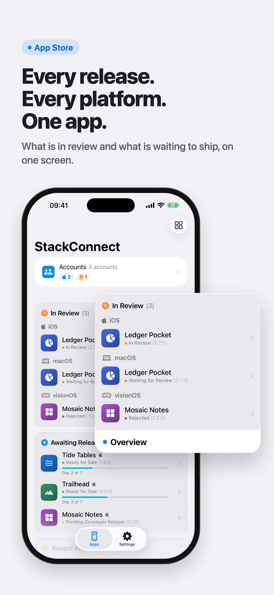
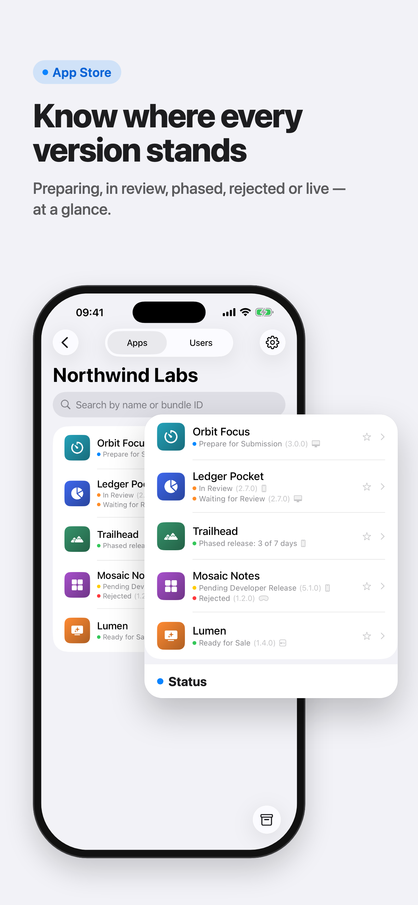
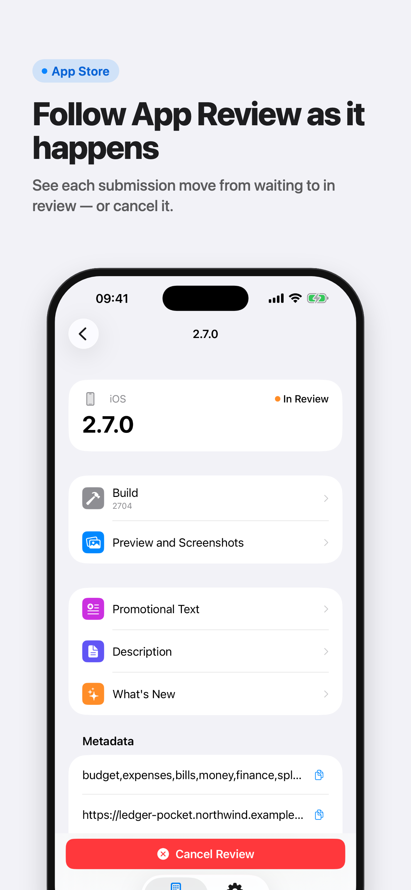
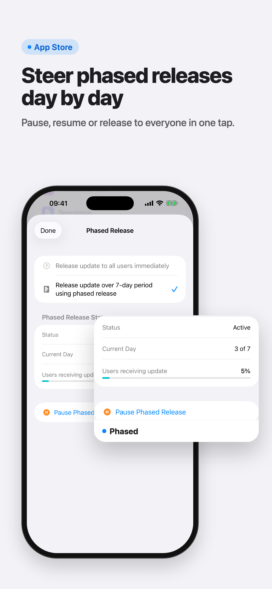
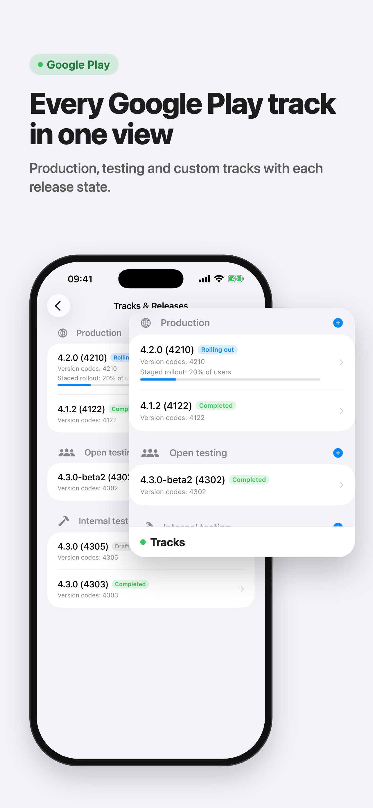
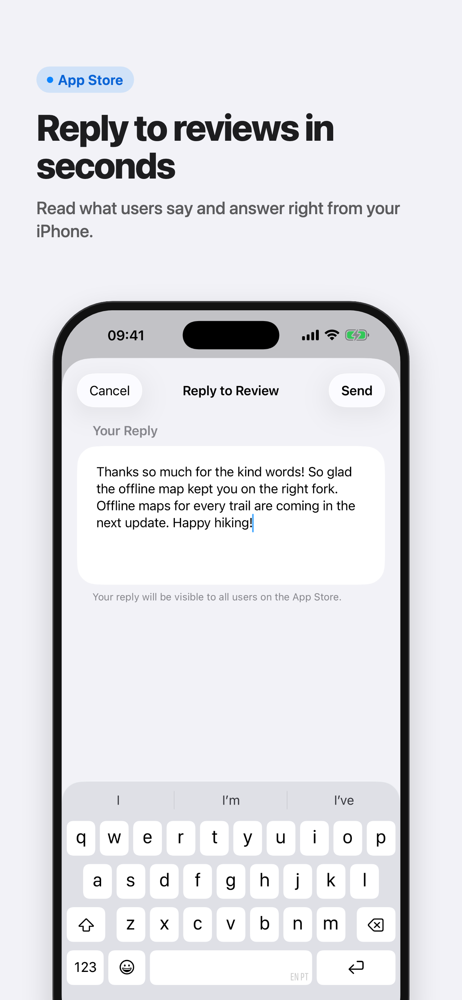
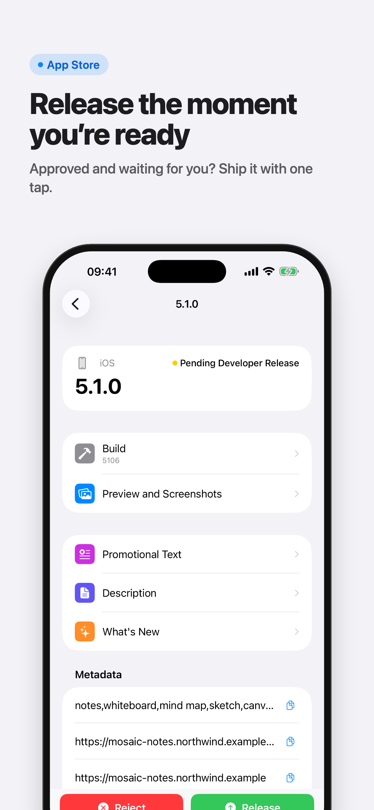
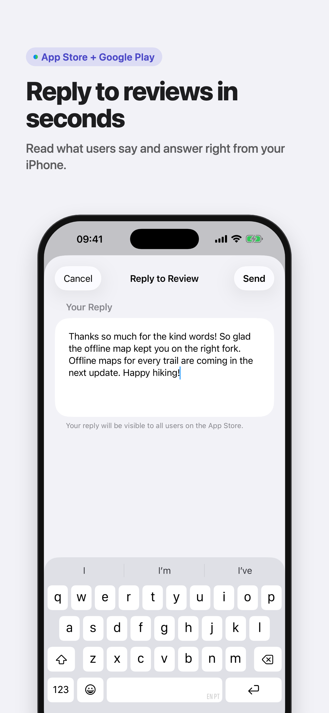

# StackConnect

A native iOS app to manage your **App Store Connect**, **Firebase**, and **Google Play** developer accounts from a single place. From a unified interface you can browse apps, edit version metadata, manage TestFlight groups, reply to customer reviews, view analytics, manage Firebase Remote Config and FCM campaigns, and securely export/import accounts to share with your team.

Built with SwiftUI for iOS 17+.

## Download

<a href="https://apps.apple.com/br/app/stackconnect/id6761390987">
  
</a>

[Download StackConnect on the App Store](https://apps.apple.com/br/app/stackconnect/id6761390987)

## Running the app

### Requirements
- Xcode 16.3+
- iOS 17.0+
- [XcodeGen](https://github.com/yonaskolb/XcodeGen)

### Steps

1. Clone the repository:
   ```bash
   git clone https://github.com/r1b2ns/stack-connect.git
   cd stack-connect
   ```

2. Generate the Xcode project (the `.xcodeproj` is not checked in):
   ```bash
   xcodegen generate --spec project.yml
   ```

3. Open `StackConnect.xcodeproj` in Xcode.

4. Select the **StackConnect Development** scheme and run on a simulator or device.

> Re-run `xcodegen generate --spec project.yml` whenever source files, Swift package dependencies, or build settings change.

## Analytics

StackConnect sends anonymous usage analytics (screens viewed, buttons tapped, action outcomes) through Google Analytics for Firebase, and crash reports through Firebase Crashlytics. No account names, keys, bundle IDs, app data, advertising identifiers (IDFA) or IDFV are collected, and the app does not use App Tracking Transparency.

- **What is sent.** Fixed, coarse values only: screen and button names, action outcomes, error *categories* (e.g. `network`, `server` — never an error message), whether an error was shown full screen or inline, sync trigger and a bucketed duration, where the app was opened from (notification, widget, URL) and the route kind, on iPad and Mac the kind of sidebar section opened and whether it came from the sidebar, a menu command or a dashboard tile (never an account name or ID), the Reviews inbox filter, bucketed search result counts (never the search text), and a few segment properties (`account_count` bucket, which stores are set up, `notifications_enabled`, and `ui_layout`: `compact` or `regular`).
- **Crash reports.** Crashlytics collects crash stack traces and device/OS details. A few handled errors (service failures and unclassified errors) are also recorded as non-fatals with only their error domain, code and category; messages, URLs and response bodies are stripped. Release builds upload dSYMs to Crashlytics so crashes are symbolicated; the upload script is skipped when `GoogleService-Info.plist` is absent or for simulator builds.

- **Optional config.** Firebase is enabled only when `StackConnect/Resources/GoogleService-Info.plist` exists. The file is git-ignored and is never committed. Without it, the app builds and runs normally and events only go to the unified log (visible in Console in DEBUG).
- **Using your own Firebase project.** Drop your `GoogleService-Info.plist` into `StackConnect/Resources/` and re-run `xcodegen generate --spec project.yml` (XcodeGen bundles the file only if it is there when the project is generated).
- **Opt-out.** Analytics is on by default and can be turned off in **Settings → Privacy → Share usage analytics**; the same setting covers crash reports. Firebase collection starts disabled at every launch (`FIREBASE_ANALYTICS_COLLECTION_ENABLED = NO`, `FirebaseCrashlyticsCollectionEnabled = NO`) and is turned on only when that setting is on, so an opted-out user sends nothing, not even `first_open` or a crash report. Turning it off stops collection; the final `analytics_disabled` event is kept so it can still be uploaded.

## Screenshots

| | | | |
|:-:|:-:|:-:|:-:|
|  |  |  |  |
|  |  |  |  |

## License

This project is licensed under the MIT License. See [LICENSE](LICENSE) for details.
