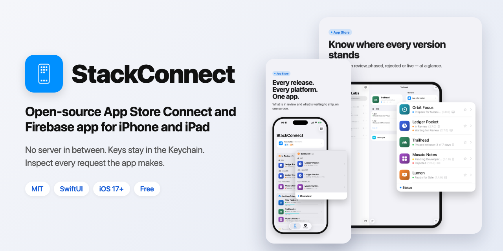
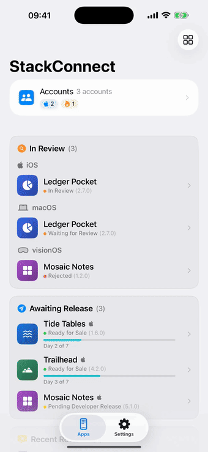

<h1 align="center">StackConnect</h1>

<p align="center">
  A free, open-source iPhone and iPad app for <b>App Store Connect</b> and <b>Firebase</b>.<br />
  Your keys stay in the Keychain, there is no server in between, and you can inspect every request the app makes.
</p>

<p align="center">
  <a href="https://github.com/r1b2ns/stack-connect/actions/workflows/ci.yml"></a>
  <a href="https://github.com/r1b2ns/stack-connect/releases/latest"></a>
  
  
  <a href="LICENSE"></a>
</p>

<p align="center">
  <a href="https://apps.apple.com/app/id6761390987"></a>
</p>

<p align="center">
  
</p>

<p align="center">
  
</p>

## Why StackConnect

The official App Store Connect app is a good monitor, but most of the work still sends you to the website: editing metadata, creating a version and submitting it, certificates and profiles, team roles. StackConnect does that work from your phone, and adds Firebase on the same screen.

Because it holds keys that can ship your builds, it is built to be verifiable:

- **No StackConnect server.** The app talks directly to Apple's App Store Connect API and Google's Firebase APIs.
- **Credentials stay in the iOS Keychain.** Sharing an account with a teammate uses an encrypted file (AES-256-GCM), scoped to the apps you choose.
- **Network Audit.** *Settings › Privacy › Network Audit* lists every request the app sends and receives, with secrets masked. Open any request to inspect it, or export the log to review it yourself.
- **Open source, MIT-licensed.** Read the code, build it yourself, or send a fix.

## Features

**Home**
- Apps in review, awaiting release and recent reviews at a glance
- Home Screen widgets for In Review, Awaiting Release and Recent Reviews
- A reminder when the Account Holder needs to accept new agreements

**App Store Connect**
- Browse apps with search, sort, favorites and archived apps
- Edit version metadata, manage localizations and preview screenshots
- Versions on iOS, macOS, tvOS and visionOS, including phased release
- Submit for review with a pre-submission checklist; cancel, release or resubmit
- App Information, category, age rating, privacy and accessibility declarations
- Read and reply to customer reviews, with reusable reply templates
- Analytics dashboard and analytics reports with daily, weekly and monthly charts
- TestFlight: beta groups, testers, builds and beta review information
- Certificates, provisioning profiles, identifiers and devices
- Team: invite members, edit roles, resources and visible apps

**Firebase**
- Browse projects and apps
- Remote Config parameters and conditions
- Cloud Messaging notifications with audience targeting

**Accounts and teams**
- Several accounts per provider, with granular permissions per account and per app
- Encrypted account export and import to share access with your team
- Offline-first: cached data loads instantly and syncs in the background

## Build from source

**Requirements:** Xcode 16.3 or later, iOS 17 or later, and [XcodeGen](https://github.com/yonaskolb/XcodeGen) (`brew install xcodegen`).

1. Clone the repository:
   ```bash
   git clone https://github.com/r1b2ns/stack-connect.git
   cd stack-connect
   ```
2. Generate the Xcode project (the `.xcodeproj` is not checked in):
   ```bash
   xcodegen generate --spec project.yml
   ```
3. Open `StackConnect.xcodeproj`, pick the **StackConnect** scheme and run it on a simulator.
4. To run on your own device, copy `Configs/Local.xcconfig.example` to `Configs/Local.xcconfig` (git-ignored), set your team, bundle identifier and App Group as explained in the file, and generate the project again.

Re-run `xcodegen generate --spec project.yml` whenever files, packages or build settings change.

The Rust core (`StackCoreRust`) is a prebuilt binary that Xcode/SwiftPM downloads automatically from the [stack-connect-core releases](https://github.com/r1b2ns/stack-connect-core/releases) on first package resolution (~65 MB), so no Rust toolchain is needed.

### Try it without an account

Pick the **StackConnect Fake Data** scheme. It runs the app on invented, realistic demo accounts with no network, no Keychain and no API keys, which is the quickest way to explore the app or work on a screen.

### Firebase (optional)

Analytics and crash reporting are enabled only when `StackConnect/Resources/GoogleService-Info.plist` exists. The file is git-ignored and never committed. Without it, the app builds and runs normally and events only go to the unified log (visible in Console in DEBUG builds). To use your own Firebase project, drop your `GoogleService-Info.plist` into `StackConnect/Resources/` and generate the project again.

DEBUG builds never send analytics or crash reports to Firebase, even with the plist: Firebase is configured only for Remote Config. To check events in Firebase DebugView, launch a DEBUG build with `-StackAnalyticsSendToFirebase YES -FIRDebugEnabled`.

## Architecture

- **SwiftUI, MVVM + Coordinator.** Each module has a Factory, an Entry that owns the state objects, a View generic over its ViewModel protocol, and a Coordinator with a route enum. See [CONTRIBUTING.md](CONTRIBUTING.md) for the template.
- **Local Swift packages** under `Packages/` for shared protocols, storage, crypto and the API providers.
- **Offline-first storage:** app data in SwiftData, secrets in the Keychain, small preferences in UserDefaults.
- **Rust core** ([stack-connect-core](https://github.com/r1b2ns/stack-connect-core)) for networking and authentication, bridged to Swift with UniFFI.
- **XcodeGen** generates the project from `project.yml`.

## Privacy

StackConnect sends anonymous usage analytics (screens and buttons used, action outcomes, error categories) through Google Analytics for Firebase, and crash reports through Firebase Crashlytics. It never collects account names, keys, bundle IDs, app data or advertising identifiers, and it does not track you across apps. Both can be turned off in *Settings › Privacy › Share usage analytics*; when that setting is off, Firebase collection stays disabled from launch. You can verify all of this in Network Audit. Details are in [PRIVACY.md](PRIVACY.md).

## Roadmap

- **Google Play Console**: in development, not part of the App Store build yet.
- Ideas and planned work live in [issues](https://github.com/r1b2ns/stack-connect/issues) and [Discussions](https://github.com/r1b2ns/stack-connect/discussions).

## Contributing

Contributions are welcome, from fixing a typo in a translation to adding a new provider. Start with [CONTRIBUTING.md](CONTRIBUTING.md) and the issues labeled [good first issue](https://github.com/r1b2ns/stack-connect/labels/good%20first%20issue). Please follow the [Code of Conduct](CODE_OF_CONDUCT.md), and report security issues privately as described in [SECURITY.md](SECURITY.md).

If StackConnect saves you time, you can support it with an optional tip inside the app.

## License

StackConnect is released under the MIT License. See [LICENSE](LICENSE).

StackConnect is an independent project and is not affiliated with, endorsed by or sponsored by Apple Inc. or Google LLC. App Store Connect, TestFlight, iOS, iPadOS, macOS, tvOS and visionOS are trademarks of Apple Inc. Firebase and Google Play are trademarks of Google LLC.
